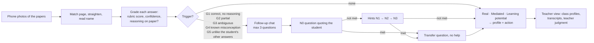

# AsksBack

**The grader that asks back.** AsksBack grades a scanned written exam and, only where the paper is not enough evidence of what the student knows, gives the student a short written follow-up with graded hints. The teacher gets three scores and a profile for each student instead of a single grade: who is *Almost there* behind a low score, who needs reteaching, and whose answers to talk through.

**Tour:** open [`/tour`](public/tour.html) on the running app (<http://127.0.0.1:5002/tour> locally). It is the five-minute pitch as a slideshow. The video script is in [docs/demo-script.md](docs/demo-script.md).

## The science, in short

- **Asking for the reason exposes what the answer hides** (two-tier diagnostics, Treagust 1988). A right answer with no reasoning is not evidence of understanding.
- **Dynamic assessment** (Vygotsky; Feuerstein; Poehner & Lantolf 2013): how much help a student needs to get there measures their development. It yields an actual score, a mediated score and a learning-potential score.
- **Interactive orals** resist outsourced answers and measure well, but teachers lack the time (Sotiriadou et al. 2019; Huxham et al. 2012). A short written follow-up, only where needed, scales.
- **AI-led follow-ups work** when the questions are benevolent, necessary, contextual and open (Socratic Mind 2025; *Scientific Reports* 2026).

The full rationale and references are in [docs/concept.md](docs/concept.md). Every choice the concept left open is in [docs/decisions.md](docs/decisions.md).

## How it works



- **One trigger per question, at most three questions per student, at most three hints per question.** The question type is fixed by the trigger; only the wording adapts.
- **Every question is checked before it is sent:** benevolent, necessary, quotes the student, open (not yes/no), one idea, and no giveaway at N0/N1. A failing question is rewritten; after two tries the teacher's own hint is used.
- **Scoring is code.** The model only judges whether a reply meets a rubric criterion. Mediated credit uses the teacher's weights (default N0 100%, N1 75%, N2 50%, N3 25%); a failed transfer question lowers it one level. Learning potential is `(mediated − real) / (max − real)`.
- **Profiles:** Mastered, Almost there, Building, Not reached, Verify understanding. G5 never accuses: the student gets a new case to apply the idea to, and the teacher decides.
- **Demo metrics:** the share of the class that was *Almost there* behind a low grade, and agreement between the generated profiles and the teacher's own judgment.

## Repository

| Path | What |
|---|---|
| `worker/asksback/` | Python 3.12 worker (uv): scan alignment, OCR, grading, triggers, follow-up writing and checking, the mediation ladder, scoring, the Firebase worker |
| `public/` | Web apps, vanilla JS ES modules with no build step: `teacher`, `student` (the follow-up chat), `capture` (phone scanning), `tour` |
| `firestore.rules`, `storage.rules` | Students read only their own follow-up and write only replies, inside the reply window |
| `docs/` | Concept, decisions, demo script |

## Run it locally

Needs [uv](https://docs.astral.sh/uv/), the [Firebase CLI](https://firebase.google.com/docs/cli) and Java 21 (for the emulators). No Firebase project or AI key is needed: the emulators run the `demo-asksback` project offline, and mock mode needs no model.

```bash
firebase emulators:start --only auth,firestore,storage,hosting
```

```bash
cd worker && uv sync && uv run python -m asksback worker --emulator --model mock
```

Then open <http://127.0.0.1:5002/teacher>, create an account, and press **＋ Demo class**. Scan the five demo papers from **Scan papers → Upload demo photos**, and answer as a student at <http://127.0.0.1:5002/student> (on the emulator, a panel signs you in as one of the scanned students).

**With a real model:** copy `worker/.env.example` to `worker/.env`, add `ANTHROPIC_API_KEY` or `OPENROUTER_API_KEY`, and start the worker with `--model claude` or `--model openrouter`.

### Deploy

The hosted project is `test-scanner-a42` (alias `prod`). Deploying replaces that project's hosting, Firestore and Storage rules:

```bash
firebase deploy --project prod --only hosting,firestore,storage
```

Run the worker against it with a service account key (never commit it; `service-account*.json` is git-ignored):

```bash
cd worker && uv run python -m asksback worker --project test-scanner-a42 --key service-account.json --model claude
```

The GitHub workflows deploy hosting when the repository variable `FIREBASE_PROJECT_ID` and the secret `FIREBASE_SERVICE_ACCOUNT` are set.

### Tests

```bash
cd worker && uv run pytest -q
```

The end-to-end test drives the whole demo in a headless browser against the running emulators and a mock worker (teacher, scanning, Bruno's follow-up in the chat, security rules, profiles, weights, tour):

```bash
cd worker && uv run playwright install chromium && uv run python e2e/web_flow.py
```

Other worker commands: `uv run python -m asksback --help` (`run` grades an exam folder offline and prints the follow-ups, `synth` generates the handwritten demo quiz, `demo-assets` regenerates `public/demo`).
